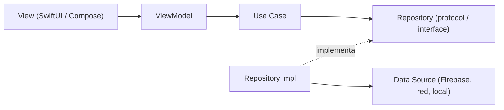

# 🏗️ Arquitectura

Ambas apps siguen **Clean Architecture + MVVM organizada por Features**, con paridad 1:1 de nombres y carpetas.

- **Presentation** depende de **Domain**.
- **Data** depende de **Domain** (implementa sus contratos).
- **Domain** no depende de nadie (ni Firebase, ni UI frameworks).

## Equivalencias

| Concepto | Flutter | iOS (Swift) | Android (Kotlin) |
|----------|---------|-------------|------------------|
| Vista | `Widget` | `View` (SwiftUI) | `@Composable` |
| Estado / lógica de UI | `ChangeNotifier` / `Bloc` | `@Observable` ViewModel | `ViewModel` + `StateFlow` |
| Contrato | `abstract class` | `protocol` | `interface` |
| Modelo de negocio | clase inmutable | `struct` | `data class` |
| Asincronía | `Future` / `Stream` | `async/await` / `AsyncStream` | `suspend` / `Flow` |
| Dependencias | `pubspec.yaml` | Swift Package Manager | `libs.versions.toml` + Gradle |

## Estructura de una Feature

| Capa | iOS | Android |
|------|-----|---------|
| Presentation | `Features/Auth/Presentation/{Views,ViewModels}` | `features/auth/presentation` |
| Domain | `Features/Auth/Domain/{Entities,UseCases,Repositories}` | `features/auth/domain` |
| Data | `Features/Auth/Data/{DataSources,Repositories,DTOs}` | `features/auth/data` |

## Design System
Componentes propios (`PrimaryButton`, `AppTextField`, colores, tipografía) en `Core/UI` + `Core/DesignSystem` (iOS) y `core/ui` + `ui/theme` (Android). Las pantallas **solo** usan estos componentes para garantizar paridad visual.
